# AI-фотоника

**Задача.** Мы рассматриваем задачу, в которой имеются четыре изображения 128×128. Требуется получить один файл — фазовую маску 128×128, 8 бит, grayscale. При помещении этой маски в оптическую схему (лазер 532 нм, шаг пиксела 10 мкм, плоская волна) на расстояниях 24,1 / 25,3 / 26,5 / 27,7 мм должны последовательно восстановиться все четыре изображения, каждое в своей плоскости.

**Почему задача нетривиальна.** Одна маска содержит 16 384 числа. Четыре изображения — 65 536 отсчётов. Расстояния различаются на 3–5 %, то есть плоскости связаны масштабом и не могут рассматриваться как независимые каналы. Система заведомо недоопределена; вопрос состоит не в том, как решить её точно, а в том, какая доля информации физически переносима одной маской.

**Предлагаемый подход.** Мы разработали нейросеть, в прямой проход которой встроена физическая модель. U-Net (11,59 млн параметров) формирует начальную фазу; далее выполняются 2048 дифференцируемых шагов спуска по физическому лоссу с расчётом дифракции Френеля на всех четырёх расстояниях, после чего прямо в сети производится квантование в 8 бит. На выходе мы получаем один прямой проход: 54 секунды на процессоре, без итерационной доводки после сети и без выбора из вариантов.

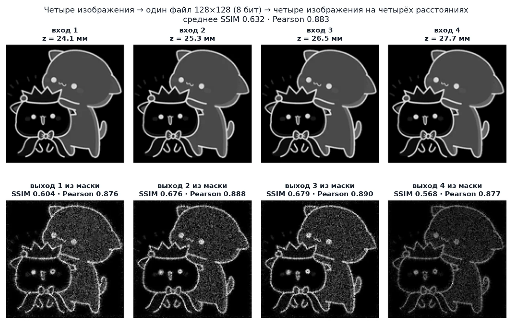

Слева показаны входные данные, справа — результат восстановления из одного файла. Числа на панелях соответствуют метрикам именно этой плоскости.

## Что именно сдаётся

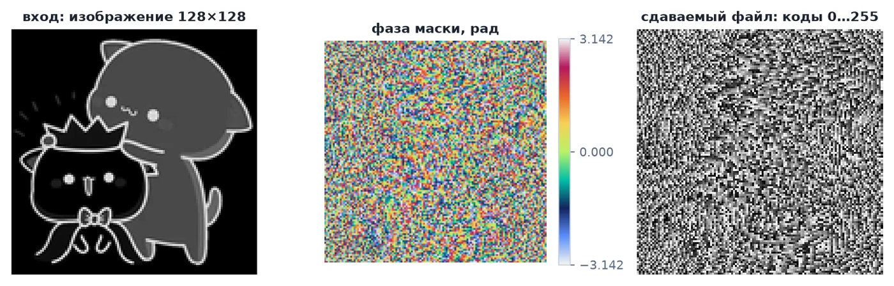

Мы сдаём один PNG: 128×128, режим `L`, 8 бит, коды 0…255 (0 ↔ −π, 255 ↔ +π). Слева приведён вход, в центре — фаза маски в циклической палитре, справа — сам файл, то есть то, что печатается как ДОЭ. Метрики в `outputs/metrics.json` мы вычисляем именно по этому файлу, прочитанному обратно как 8-битное изображение, а не по «внутренней» фазе сети.

## Интерфейс

Дашборд мы сделали для того, чтобы можно было проследить путь изображения и исследовать физику интерактивно. Имеются пять вкладок; все расчёты выполняются на месте, данные совпадают с файлами сдачи.

**Физика.** Загрузка собственных изображений (1–4 файла, перетаскиванием), свип по z от 24,06 до 28 мм с метками плоскостей, маска ДОЭ в палитре и в 8 битах, гистограмма кодов, плоскости в режимах «шторка», «два в ряд» и «разница».

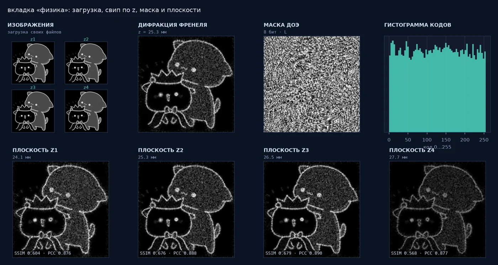

**Тест.** Выбор комплекта, прогон сетью, четыре восстановления, метрики по плоскостям и сравнение train / val / test на одном графике.

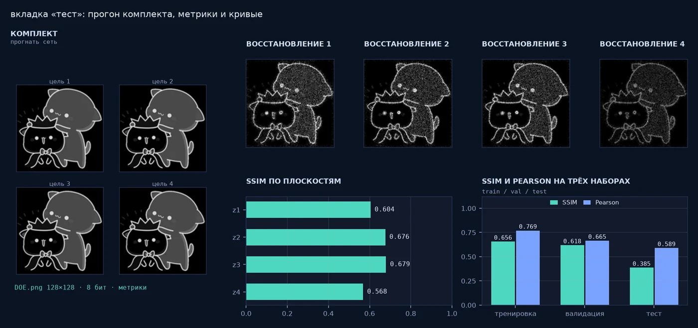

**Алгоритм.** Конвейер из семи шагов с подсветкой текущего шага, маска на шагах 0 → 683 → 1365 → 2047 и Pearson на каждом из них.

**Модель и запуск.** Граф весов с гистограммами по слоям, активации от входа к голове, таймлайн обучения; отдельно — этапы конвейера с живым логом и кнопкой «стоп», которая останавливает процесс за десятые доли секунды.

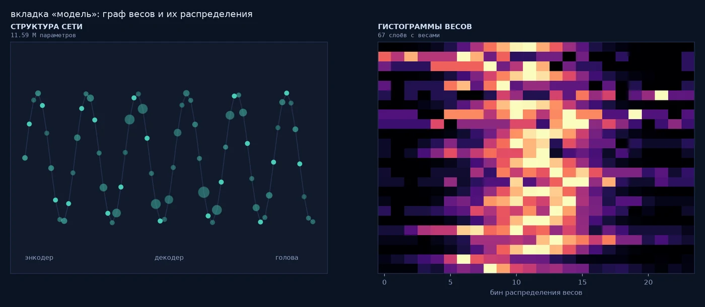

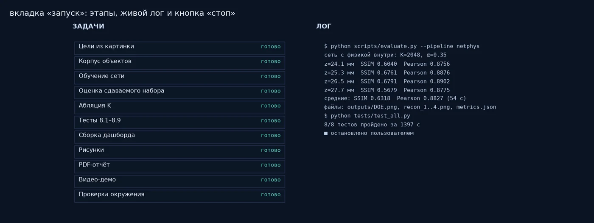

Сервер принимает только имена этапов из белого списка и идентификаторы комплектов — никаких команд из браузера он не исполняет.

## Анимации

Свип по z вокруг второй плоскости: изображение формируется только на своём расстоянии, а в стороне превращается в шум.

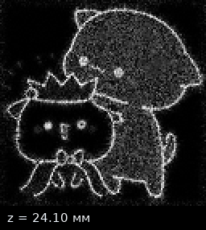

Путь от произвольного изображения до маски и обратно — ровно то, что выполняет `hdoe/prepare.py` с любым входным файлом:


Вход принимается любой: цвет, альфа-канал, EXIF-поворот, произвольный размер. Приведение к формату задачи выполняется автоматически — яркость, авто-кроп объекта, квадрат, LANCZOS до 128×128, инверсия полярности, выравнивание энергии.

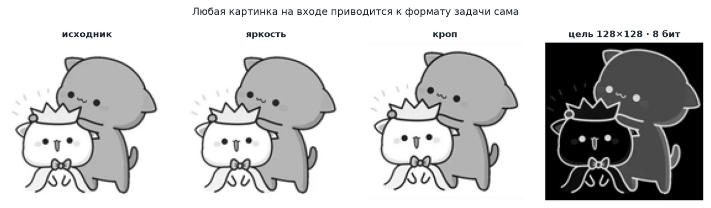

Инверсия не является косметической операцией: без неё GS даёт Pearson 0,41 вместо 0,81, поскольку одно-БПФ-схема переносит светлые детали, а не тёмные.

## Из чего состоит обучающая выборка

Сеть учится не на фотографиях, а на синтетическом корпусе: 1200 кадров
128×128, собранных генератором `hdoe/corpus.py` (зерно фиксировано, корпус
воспроизводится `python -m hdoe.corpus`). Ни одного взятого извне снимка —
и это главная причина того, что на реальных фотографиях результат падает.

Алфавит — девять семейств пятен на тёмном фоне:

| семейство | что рисуется | диапазон параметров |
|---|---|---|
| кольцо | окружность, в половине случаев с разрывом дуги | радиус 8–48 px, толщина 2–9 px |
| диск | залитый круг, в половине случаев с вырезом | радиус 5–45 px |
| крест | две пересекающиеся полосы | ширина 3–14 px, лучи 15–55 px |
| рамка | прямоугольное кольцо | стороны 18–52 px, толщина 4–14 px |
| штрихи | 2–4 отрезка под случайными углами, «буква» | длина 12–45 px, толщина 2,5–7 px |
| спираль точек | цепочка из 12–46 точек, радиус нарастает | шаг 0,6–1,0 px, точка 1,5–5 px |
| пятна | 2–5 гауссовых клякс | σ 3–12 px |
| многоугольник | пересечение полуплоскостей, 3–6 сторон | радиус 14–46 px |
| сетка точек | регулярная решётка точек — «дискретный» объект | шаг 9–18 px, точка 1,8–4 px |

Кадр собирается так: 1–2 семейства накладываются по максимуму, с вероятностью
0,35 добавляется мелкая деталь третьего типа с яркостью 0,65, затем лёгкая
бинаризация и обрезка фона. Пустой кадр отбраковывается и генерируется заново.
Заполнение получается около 19 % площади — объект, а не текстура.

Четвёрка для одной маски — это четыре случайных кадра корпуса, у которых
выравнена суммарная энергия и применена общая для всех четырёх каналов
аугментация (сдвиг до ±8 px, отражения, поворот на 90°), плюс поканальная
фотометрия. Для «плотных» целей фотометрия отключается: с ней валидация
падала на 0,1 PCC.

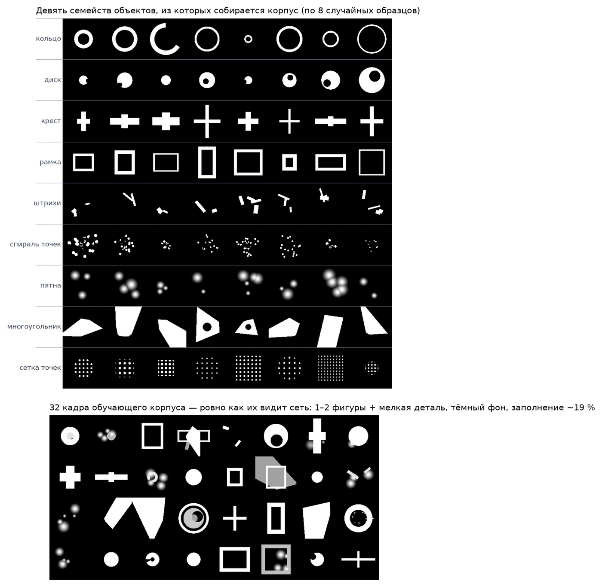

Верхняя часть — по восемь случайных образцов каждого семейства, нижняя —
32 кадра ровно в том виде, в каком их видит сеть. Отсюда видно и сильную
сторону, и ограничение: модель училась на «объект на тёмном фоне», поэтому
на штриховке, буквах и фотографиях она проседает (см. таблицу ниже).

Сдаваемый набор `data/targets` в обучении не генерировался, но участвовал как
«маяк» для учительской маски, поэтому метрика на нём — не независимый тест.

## Результаты: тренировка, валидация, тест

Мы используем один и тот же чекпоинт `outputs/best.pt`, один прямой проход, метрики считаем по квантованной 8-битной фазе. Три набора не пересекаются:

| набор | что это | n | SSIM | Pearson |
|---|---|---:|---:|---:|
| тренировка | четвёрки корпуса, на которых шла дистилляция | 8 | 0,656 | 0,769 |
| валидация | четвёрки корпуса с отдельным зерном, в обучении не были | 8 | 0,618 | 0,665 |
| тест | сдаваемый набор и пять готовых комплектов | 6 | **0,386** | **0,589** |

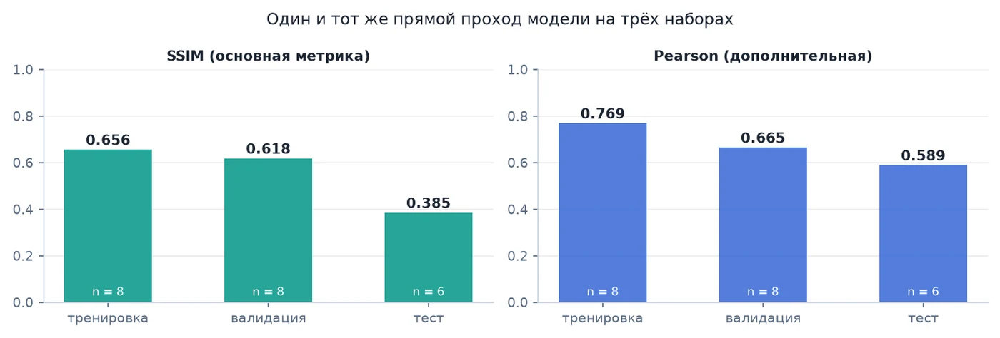

Разрыв между валидацией и тестом — главный содержательный вывод нашей работы. Корпус, на котором обучалась сеть, состоит из объектов типа «пятно на тёмном фоне». На таких изображениях модель сохраняет SSIM 0,62; на других типах изображений качество заметно снижается.

По тестовым комплектам:

| комплект | что это | SSIM | Pearson |
|---|---|---:|---:|
| `data/targets` | сдаваемый набор заказчика | 0,638 | 0,883 |
| `sample-textures` | штриховка, рябь, точки | 0,444 | 0,582 |
| `sample-letters` | знаки с резкими краями | 0,384 | 0,400 |
| `sample-shapes` | круг, квадрат, треугольник, крест | 0,369 | 0,543 |
| `sample-gradients` | плавные переходы яркости | 0,279 | 0,440 |
| `sample-photo` | фрагменты реального снимка | 0,199 | 0,687 |

Необходима оговорка относительно первой строки: сдаваемый набор участвовал в обучении как «маяк» для учительской маски, поэтому значение 0,638 не является независимым тестом. Объективные показатели переноса, которые мы получили, — валидация 0,618 и тест 0,386.

По плоскостям на сдаваемом наборе (нормированный протокол):

| плоскость | z, мм | SSIM | Pearson | SSIM без нормировки |
|---|---:|---:|---:|---:|
| z₁ | 24,1 | 0,6040 | 0,8756 | 0,0707 |
| z₂ | 25,3 | 0,6761 | 0,8876 | 0,1070 |
| z₃ | 26,5 | 0,6791 | 0,8902 | 0,1225 |
| z₄ | 27,7 | 0,5679 | 0,8775 | 0,1155 |
| среднее | | **0,6318** | **0,8827** | 0,1039 |

SSIM мы вычисляли с окном 11×11, гауссовым σ = 1,5, C₁ = 10⁻⁴, C₂ = 9·10⁻⁴ и обрезкой 5 пикселей; результат численно совпадает с `skimage.metrics.structural_similarity`. Pearson вычислялся по всем 16 384 элементам. Основной протокол нормирует реконструкцию в [0,1], справочный — нет; в справочном протоколе SSIM падает до 0,10, поскольку уровни интенсивности в плоскости не совпадают с уровнями цели. Это ожидаемое поведение, а не ошибка.

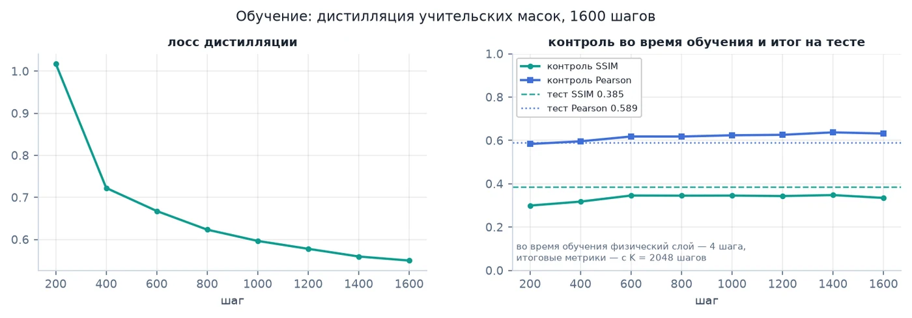

Во время обучения физический слой выполняет 4 шага (иначе память растёт как O(K)), а итоговые метрики мы считаем при K = 2048. Контрольные метрики в логе получены на одной фиксированной четвёрке, поэтому они выше теста: это не подмена, а разные наборы.

### Вклад физического слоя внутри сети

Мы используем одни и те же веса; изменяется только число шагов физического слоя:

| K | 0 | 8 | 96 | 384 | 1024 | 2048 |
|---|---:|---:|---:|---:|---:|---:|
| Pearson | 0,486 | 0,756 | 0,842 | 0,871 | 0,878 | **0,883** |
| SSIM | 0,141 | 0,450 | 0,594 | 0,612 | 0,633 | **0,638** |

Без физического слоя сеть выдаёт результат, близкий к усреднённой маске (SSIM 0,14). Архитектура такова: на входе U-Net, на выходе карта (c, s), фаза φ = atan2(s, c); далее выполняются K шагов градиентного спуска по маске, на каждом из которых рассчитывается дифракция на четырёх расстояниях, и только после этого производится квантование в 8 бит.

Классический многоплоскостной алгоритм Герчберга–Саксона (250 итераций, 3 перезапуска, 100 итераций доводки) даёт на сдаваемом наборе 0,417 / 0,797 — хуже по обеим метрикам и существенно дольше. Он же служил источником учительских масок для дистилляции; вторую стадию дистилляции по сквозному лоссу мы проверили и отключили, поскольку качество с ней снижалось.

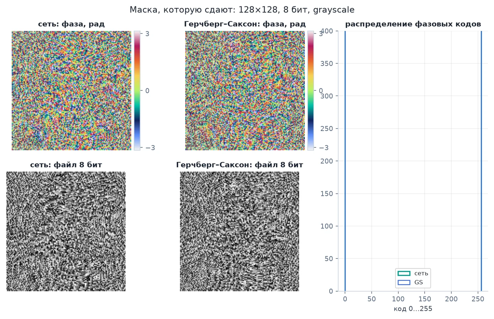

Слева показана маска сети, справа — результат GS. Распределение кодов у сети заметно ближе к равномерному: она использует весь диапазон 8 бит, а не концентрируется на нескольких уровнях.

### Поведение изображения по z

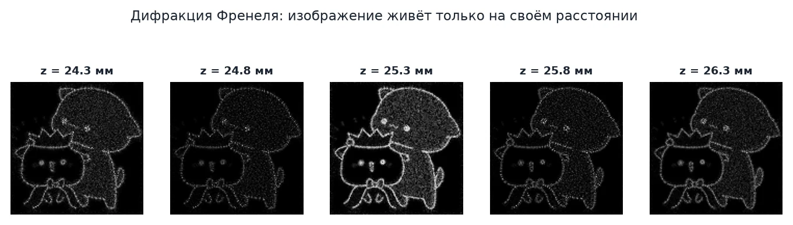

Интенсивность нормируется по кадру, поэтому «яркость» здесь относительна. Существенно другое: структура формируется на своём расстоянии и расплывается на соседних. Именно это ограничивает систему — четыре плоскости конкурируют за одну и ту же маску.

### О физической модели

Поле мы рассчитываем дискретной одно-БПФ-схемой Френеля (свёртка с чирпом):

```
U(x, y; z) = Q_out(z) · FFT{ Q_in(z) · U₀ }
Q_in  = exp(iπ(x² + y²) / (λz))
Q_out = exp(iπ(x′² + y′²) / (λz)),  x′ = λz / (NΔx)
```

Шаг выходной сетки Δx′ = λz/(NΔx) составляет 10,0…11,5 мкм, то есть выходные плоскости оказываются слегка растянутыми (s = 1,00…1,07). Это свойство схемы, а не дефект реализации; оно же объясняет, почему четыре изображения нельзя восстановить независимо: одиночная маска переносит полосно-ограниченный класс изображений, а плоскости связаны масштабом.

Схема применима при z ≥ NΔx²/λ = 24,0602 мм. Первая плоскость, 24,1 мм, отстоит от этой границы на 0,17 %, и код выводит предупреждение при каждом прогоне. Формально это грань применимости, практически результат устойчив: пару «одно-БПФ + z₁ = 24,1 мм» мы сверили с угловым спектром (SSIM 0,9997 между схемами). `tests/test_all.py` проверяет закон Парсеваля, фокусировку линзы, round-trip квантования, gradcheck в `complex128`, кросс-схемную сверку, границу применимости и форматы PNG — все восемь тестов проходят.

## Запуск

Требуется только Docker. Всё остальное находится внутри образа: PyTorch, физика, веса, дашборд. Установка библиотек и дополнительная настройка не требуются.

```bash
docker compose up --build          # первый раз ~4 минуты
```

Открыть <http://localhost:8000>. В левом верхнем углу плитки образцов расположена кнопка «загрузить»: через неё можно перетащить собственные изображения и сразу прогнать их сетью.

Без compose:

```bash
docker build -t hdoe .
docker run --rm -p 8000:8000 hdoe
```

Тома не обязательны, но с ними загруженные комплекты и результаты сохраняются на хосте:

```bash
docker run --rm -p 8000:8000 \
  -v "$PWD/data/sets:/app/data/sets" -v "$PWD/outputs:/app/outputs" hdoe
```

Состав образа: `python:3.11-slim`, ffmpeg, `torch` (CPU-сборка), остальное из `requirements.txt`. При сборке мы проверяем наличие `outputs/best.pt` и импорт всех библиотек — без весов образ намеренно не собирается. `HEALTHCHECK` обращается к `/api/state`, поэтому `docker ps` показывает `healthy`. Первый прогон пользовательского комплекта занимает около двух минут на процессоре: это 2048 шагов физики внутри сети, а не отдельная доводка после неё.

Без Docker, для разработки:

```bash
python -m venv .venv && .venv/bin/pip install -r requirements.txt
.venv/bin/python scripts/serve_dashboard.py     # http://127.0.0.1:8765
```

Дашборд работает и как обычный файл: `dashboard/index.html` открывается двойным кликом, данные встроены в `data_bundle.js`. Без сервера недоступны только загрузка собственных изображений и кнопки запуска.

## Воспроизведение чисел и рисунков

```bash
python scripts/generate_main.py        # метрики train/val/test + все картинки README
python scripts/generate_main.py --no-splits --only docs   # только картинки
```

`generate_main.py` последовательно вызывает `eval_splits.py` (метрики на трёх наборах, около 25 минут на CPU), `make_readme_figures.py`, `make_ui_shots.py`, `make_readme_gifs.py` и сжимает результат в WebP. Все числа берутся из `outputs/metrics.json`, `outputs/splits.json` и `outputs/train_log.json` — ничего не вписано вручную. Если метрики уже посчитаны, рисунки пересобираются за полминуты: `--no-splits --only docs`.

Остальные точки входа:

```bash
python scripts/evaluate.py                         # DOE.png + recon + metrics.json
python scripts/infer_set.py --set data/sets/sample-shapes
python tests/test_all.py                           # 8 проверок физики и форматов
python scripts/build_dashboard.py                  # бандл дашборда
```

Проверки, выявляющие отказ кнопок:

```bash
cd tools && npm install && cd ..
node tools/smoke_tabs.js                              # 32 проверки офлайн-дашборда
node tools/smoke_runner.js  http://127.0.0.1:8000     # 45 проверок API
node tools/smoke_runner_ui.js http://127.0.0.1:8000/  # 31 проверка кнопок
```

## Структура репозитория

```
hdoe/          физика, сеть, физика внутри сети, метрики, подготовка входа
scripts/       точки входа (generate_main.py — всё для README)
dashboard/     index.html, app.js, style.css, data_bundle.js
data/targets/  сдаваемый набор, data/sets/ — готовые комплекты
outputs/       best.pt, DOE.png, recon_1..4.png, metrics.json, splits.json
docs/          картинки и анимации для этого README
Dockerfile · docker-compose.yml · requirements.txt
```

## Ограничения

Физически невозможно восстановить то, чего нет в маске: мозаику с периодом в пиксель, мелкий шум, резкие углы. Мы проверили это на фракталах и сетках — Pearson сохраняется, SSIM близок к нулю, и это предел схемы, а не обучения.

Перенос на произвольные фотографии остаётся слабым местом: 0,386 SSIM на тесте против 0,618 на валидации. Это лечится расширением корпуса учительских масок (`python -m hdoe.corpus`) и дообучением, но представляет собой отдельную работу.

## Литература

Goodman, *Introduction to Fourier Optics*; Voelz, *Computational Fourier Optics*; Matsushima & Shimobaba (2009) — band-limited угловой спектр; Ronneberger et al. (2015) — U-Net; Wang et al. (2004) — SSIM; Kingma & Ba (2015) — Adam; Gerchberg & Saxton (1972), Fienup (1982) — итеративные методы; Eybposh et al. (2020) — DeepCGH; Rymov, Starikov, Cheremkhin et al. (2025) — 3D-CGH-Net; Zlokazov, Minaeva, Rodin, Starikov, Cheremkhin, Shifrina (2023) — слойный синтез ДОЭ.