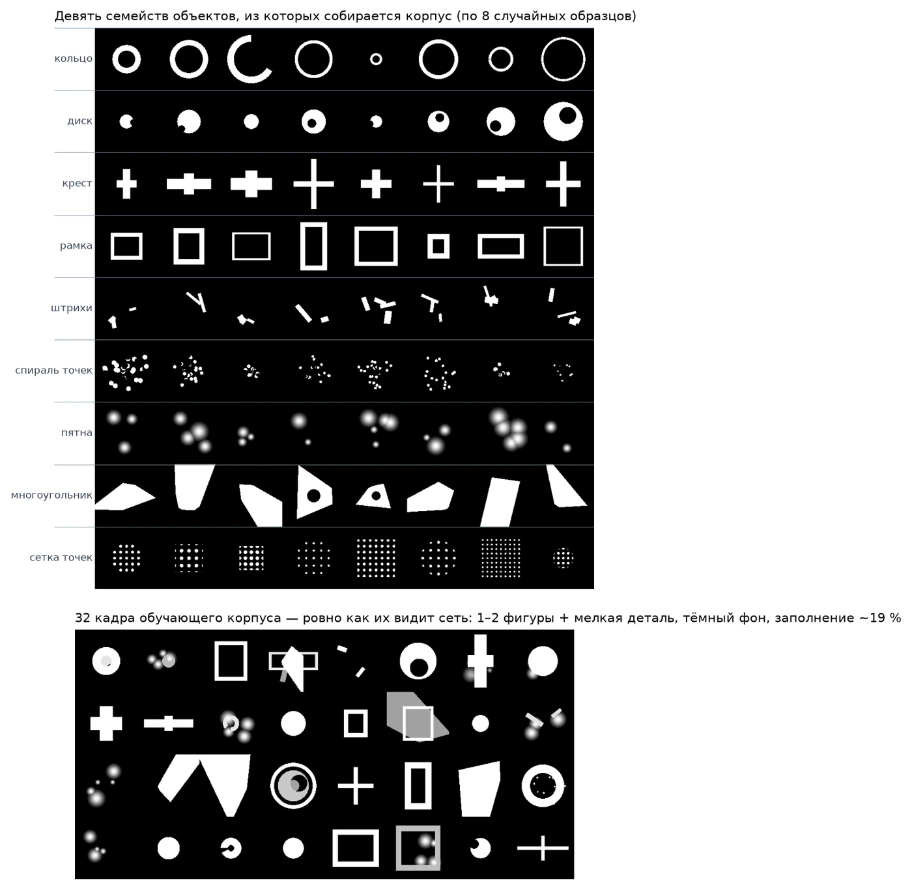

# Из чего состоит обучающая выборка

Сеть учится не на фотографиях, а на синтетическом корпусе: 1200 кадров 128×128,
собранных генератором `hdoe/corpus.py` (зерно фиксировано, корпус
воспроизводится `python -m hdoe.corpus`). Ни одного взятого извне снимка — и это
главная причина того, что на реальных фотографиях результат падает.

Алфавит — девять семейств объектов на тёмном фоне:

| семейство | что рисуется | диапазон параметров |
|---|---|---|
| кольцо | окружность, в половине случаев с разрывом дуги | радиус 8–48 px, толщина 2–9 px |
| диск | залитый круг, в половине случаев с вырезом | радиус 5–45 px |
| крест | две пересекающиеся полосы | ширина 3–14 px, лучи 15–55 px |
| рамка | прямоугольное кольцо | стороны 18–52 px, толщина 4–14 px |
| штрихи | 2–4 отрезка под случайными углами, «буква» | длина 12–45 px, толщина 2,5–7 px |
| спираль точек | цепочка из 12–46 точек, радиус нарастает | шаг 0,6–1,0 px, точка 1,5–5 px |
| пятна | 2–5 гауссовых клякс | σ 3–12 px |
| многоугольник | пересечение полуплоскостей, 3–6 сторон | радиус 14–46 px |
| сетка точек | регулярная решётка точек — «дискретный» объект | шаг 9–18 px, точка 1,8–4 px |

Кадр собирается так: 1–2 семейства накладываются по максимуму, с вероятностью
0,35 добавляется мелкая деталь третьего типа с яркостью 0,65, затем лёгкая
бинаризация и обрезка фона. Пустой кадр отбраковывается и генерируется заново.
Заполнение получается около 19 % площади — объект, а не текстура.

Четвёрка для одной маски — это четыре случайных кадра корпуса, у которых
выравнена суммарная энергия и применена общая для всех четырёх каналов
аугментация (сдвиг до ±8 px, отражения, поворот на 90°), плюс поканальная
фотометрия. Для «плотных» целей фотометрия отключается: с ней валидация падала
на 0,1 PCC.

Верхняя часть — по восемь случайных образцов каждого семейства, нижняя — 32 кадра
ровно в том виде, в каком их видит сеть. Отсюда видно и сильную сторону,
и ограничение: модель училась на «объект на тёмном фоне», поэтому на штриховке,
буквах и фотографиях она проседает.

Сдаваемый набор `data/targets` в обучении не генерировался, но участвовал как
«маяк» для учительской маски, поэтому метрика на нём — не независимый тест.
